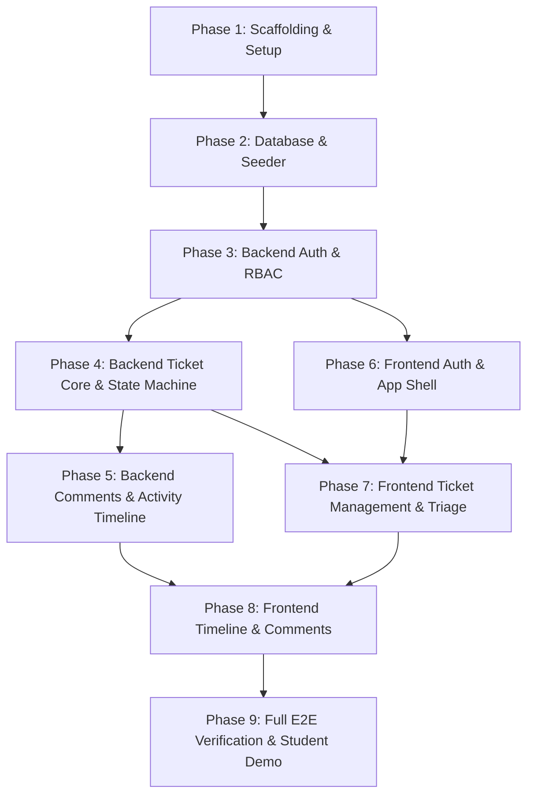

# Implementation Plan: Employee Support Ticket Management System

**Target Scope:** Student Training & Demonstration Prototype  
**Specification:** Version 1.2.0 (Approved)  
**Technology Stack:** React + Vite, Node.js + Express, MongoDB + Mongoose, Jest + Supertest  

---

## Architecture Overview

```
[ Client: React + Vite ] (Port 5173)
  ├── AuthContext (JWT in localStorage; authentic API login for demo buttons)
  ├── Pages: Login, Register, TicketList, TicketDetail, CreateTicket
  └── Components: Navbar, TicketFilter, StatusBadge, PriorityBadge, ActivityTimeline
         │
         ▼ HTTP / REST (JSON with Authorization: Bearer <token>)
[ Server: Node.js + Express ] (Port 5000)
  ├── Middleware: requireAuth, requireRole(['Support']), canAccessTicket
  ├── State Machine: Open -> In Progress -> Resolved -> Closed
  ├── Controllers: authController, ticketController, commentController
  └── Models: User, Ticket, Comment, TicketActivity
         │
         ▼ Mongoose
[ Database: MongoDB ] (Development / Test)
  └── Collections: users, tickets, comments, ticketactivities
```

---

## Phase Breakdown & Dependencies



---

### Phase 1: Project Scaffolding & Environment Setup
**Goal:** Initialize the project workspace with a clean separation between `client/` and `server/`, shared configuration, and linting/runtime scripts.

- **Dependencies:** None.
- **Tasks:**
  1. Initialize root `package.json` with convenience scripts (`dev`, `install:all`, `test:server`).
  2. Scaffold `server/` with `npm init`, installing runtime dependencies (`express`, `mongoose`, `jsonwebtoken`, `bcryptjs`, `cors`, `dotenv`) and dev/test dependencies (`jest`, `supertest`, `mongodb-memory-server`, `nodemon`).
  3. Scaffold `client/` using Vite with React template (`npm create vite@latest client -- --template react`), installing dependencies (`react-router-dom`, `axios`, `lucide-react` for clean icons, Tailwind CSS for clean student-friendly styling).
  4. Create environment variable templates: `server/.env.example` (`PORT=5000`, `MONGODB_URI=mongodb://localhost:27017/ticket_app_dev`, `JWT_SECRET=supersecretjwtkey_student_demo`, `ALLOW_SEED_RESET=true`).
- **Acceptance Criteria:**
  - `server/server.js` boots on port 5000 and responds to `GET /health` with `200 OK`.
  - `client/` compiles cleanly with Vite on port 5173.

---

### Phase 2: Database Models & Safety-Guarded Seeder
**Goal:** Establish Mongoose schemas with field constraints and implement the seed script with 3-layer safety checks.

- **Dependencies:** Phase 1.
- **Tasks:**
  1. Create Mongoose connection utility in `server/config/db.js`.
  2. Implement `User.js` model:
     - Fields: `name`, `email` (unique, lowercase), `password` (hashed, `minlength: 8`, `select: false`), `role` (`Employee` | `Support`).
  3. Implement `Ticket.js` model:
     - Fields: `title` (max 100), `description`, `category` (enum), `priority` (enum), `status` (enum, default `Open`), `createdBy` (ref: `User`), timestamps.
  4. Implement `Comment.js` model:
     - Fields: `ticketId` (ref: `Ticket`), `author` (ref: `User`), `content` (max 1000), `createdAt`.
  5. Implement `TicketActivity.js` model:
     - Fields: `ticketId`, `performedBy`, `activityType`, `details` (previousValue, newValue, message), `createdAt`.
  6. Implement `server/scripts/seed.js`:
     - Layer 1: Reject `NODE_ENV === 'production'`.
     - Layer 2: Reject unless `ALLOW_SEED_RESET === 'true'`.
     - Layer 3: Validate database URI contains `localhost`, `127.0.0.1`, `_dev`, or `_test`.
     - Seed the 4 approved users (Alice, Bob, Charlie, Diana) with hashed passwords.
     - Seed the 5 prompt sample tickets associated with Alice and Bob.
- **Acceptance Criteria:**
  - Running `npm run seed` drops dev collections and seeds 4 users and 5 tickets.
  - Running `seed.js` with `ALLOW_SEED_RESET=false` or against production immediately aborts with code 1.

---

### Phase 3: Backend Authentication & Authorization
**Goal:** Implement registration, login, profile endpoints (`GET /api/auth/me`), and role-based middleware.

- **Dependencies:** Phase 2.
- **Tasks:**
  1. Create auth helper utilities: `generateToken(userId, role)` with 24-hour expiration.
  2. Implement `authMiddleware.js`: extracts `Bearer <token>`, verifies JWT, attaches `req.user = { id, role }`.
  3. Implement `roleMiddleware.js`: higher-order function `requireRole(['Support'])` returning `403 Forbidden` on role mismatch.
  4. Implement `authController.js` and `authRoutes.js`:
     - `POST /api/auth/register`: Force `role = 'Employee'`. Reject password < 8 characters (400). Reject duplicate email (409). Return 201 with JWT.
     - `POST /api/auth/login`: Validate credentials with `bcrypt.compare`. Return 200 with JWT and user object (no password).
     - `GET /api/auth/me`: Protected by `requireAuth`. Retrieves user document by `req.user.id`, returning `id`, `name`, `email`, and `role` without exposing `password`. Returns 401 if token is missing or invalid.
  5. Implement integration tests in `server/tests/auth.test.js`:
     - Valid registration and token issuance.
     - Role tampering rejection (forcing Employee).
     - Password length enforcement (< 8 chars $\rightarrow$ 400).
     - Login with correct and incorrect credentials (200 vs 401).
     - Profile retrieval via `GET /api/auth/me` (200 with valid token, 401 with missing/invalid token, password excluded from payload).
- **Acceptance Criteria:**
  - All test cases in `auth.test.js` pass against in-memory MongoDB.

---

### Phase 4: Backend Ticket Core & State Machine
**Goal:** Implement ticket creation (`POST /api/tickets`), listing, scoping, status progression, and triage endpoints.

- **Dependencies:** Phase 3.
- **Tasks:**
  1. Implement `utils/stateMachine.js`:
     - Enforce `Open` $\rightarrow$ `In Progress` $\rightarrow$ `Resolved` $\rightarrow$ `Closed`.
     - Return `{ valid: false, code: 409 }` if ticket is `Closed`.
     - Return `{ valid: false, code: 400 }` for skips or backward transitions.
  2. Implement `ticketAccessMiddleware.js`:
     - If `req.user.role === 'Support'` $\rightarrow$ allow.
     - If `ticket.createdBy.equals(req.user.id)` $\rightarrow$ allow.
     - Otherwise $\rightarrow$ `403 Forbidden`.
  3. Implement `ticketController.js` and `ticketRoutes.js`:
     - **`POST /api/tickets` (Ticket Creation)**:
       - Accessible to both `Employee` and `Support` roles (`requireAuth`).
       - Validates: `title` (required, non-empty, max 100 characters), `description` (required, non-empty), `category` (enum), `priority` (enum).
       - Automatically sets `status = 'Open'`, `createdBy = req.user.id`, and populates timestamps.
       - Records initial `CREATED` audit event in `ticketactivities`.
       - Returns `201 Created` with the newly created ticket document.
     - `GET /api/tickets`: If Employee $\rightarrow$ query `{ createdBy: req.user.id }`; if Support $\rightarrow$ all tickets. Supports `search` (title regex), `status`, `category`.
     - `GET /api/tickets/:id`: Protected by `canAccessTicket`. Returns 200.
     - `PATCH /api/tickets/:id/status`: Restricted to Support (`requireRole('Support')`). Validates state machine; updates status and `updatedAt`; logs `STATUS_CHANGED` activity. Returns 409 if ticket is `Closed`.
     - `PATCH /api/tickets/:id/triage`: Restricted to Support. Checks status: if `Resolved` or `Closed`, returns `409 Conflict`. Updates `category`/`priority` and `updatedAt`; logs `TRIAGED` activity.
  4. Implement integration tests in:
     - `server/tests/ticket-permissions.test.js`:
       - Ticket creation by Employee (`POST /api/tickets` $\rightarrow$ 201).
       - Ticket creation by Support (`POST /api/tickets` $\rightarrow$ 201).
       - Validation failure on title > 100 chars or missing description (`POST /api/tickets` $\rightarrow$ 400).
       - Employee can view own tickets.
       - Employee cannot view other employee tickets (403).
       - Support can view all tickets.
       - Search and filtering for Employees strictly scoped to own tickets.
     - `server/tests/status-transitions.test.js`:
       - Forward-only linear progression (`Open` $\rightarrow$ `In Progress` $\rightarrow$ `Resolved` $\rightarrow$ `Closed`).
       - Rejection of skips (`Open` $\rightarrow$ `Resolved` $\rightarrow$ 400).
       - Rejection of backward transitions (`Resolved` $\rightarrow$ `In Progress` $\rightarrow$ 400).
       - Rejection of modifying status of `Closed` ticket (409 Conflict).
     - `server/tests/triage.test.js`:
       - Support triage on `Open` and `In Progress` tickets (200).
       - Triage on `Resolved` or `Closed` tickets rejected with 409 Conflict.
       - Employee triage attempts rejected with 403 Forbidden.
- **Acceptance Criteria:**
  - All ticket creation, permission, status transition, and triage tests pass.

---

### Phase 5: Backend Comments & Activity Timeline
**Goal:** Implement append-only commenting with atomic audit activity logging and chronological timeline view.

- **Dependencies:** Phase 4.
- **Tasks:**
  1. Implement `commentController.js` and routes:
     - `POST /api/tickets/:id/comments`: Protected by `canAccessTicket`. Allows commenting on tickets in any status (including `Closed`). Persists one comment in `comments` and creates one `COMMENTED` event in `ticketactivities` inside a session/transaction. Returns 201.
     - `GET /api/tickets/:id/timeline`: Retrieves all activities and comments for the ticket, merged and sorted chronologically by timestamp ascending.
  2. Confirm absence of `PUT`, `PATCH`, or `DELETE` on comments (ensuring append-only behavior).
  3. Implement integration tests in `server/tests/comments-activity.test.js`:
     - Employee can comment on own ticket (including Closed).
     - Employee cannot comment on another user's ticket (403).
     - Support can comment on any ticket.
     - Timeline returns combined chronological activities and comments.
     - Test runs on `MongoMemoryReplSet` to validate transaction support.
- **Acceptance Criteria:**
  - All comment and activity timeline integration tests pass.

---

### Phase 6: Frontend Auth, Routing & App Shell
**Goal:** Build client-side authentication, state management, protected routes, and responsive navigation.

- **Dependencies:** Phase 3.
- **Tasks:**
  1. Setup Axios API client (`client/src/api/client.js`) with request interceptor attaching `Authorization: Bearer <token>`.
  2. Implement `AuthContext.jsx`:
     - State: `user`, `token`, `isAuthenticated`, `loading`.
     - Methods: `login(email, password)`, `register(name, email, password)`, `logout()`.
     - Storage: Persists JWT in browser `localStorage`.
  3. Implement `ProtectedRoute.jsx`:
     - Redirects unauthenticated visitors to `/login`.
     - Validates optional `allowedRoles` (e.g. restricts Support-only views).
  4. Implement `Navbar.jsx`:
     - Displays brand title, user name, role badge (`Employee` vs `Support Staff`), and Logout button.
  5. Implement `LoginPage.jsx` and `RegisterPage.jsx`:
     - Form validation (email pattern, password min 8 chars).
     - **Authentic One-Click Demo Login Buttons**: Provide "Demo Login as Alice (Employee)" and "Demo Login as Charlie (Support)" buttons.
     - **No Auth Bypass**: These buttons populate the form and call the standard `login(email, password)` function executing the real `POST /api/auth/login` endpoint using seeded credentials (`Password123!`). No bypass or token forging is permitted.
- **Acceptance Criteria:**
  - User can register, log in, view role badge in Navbar, and log out.
  - Demo login buttons authenticate through the normal backend endpoint and issue real JWTs.
  - Direct navigation to protected routes redirects unauthenticated visitors to `/login`.

---

### Phase 7: Frontend Ticket List, Creation & Triage
**Goal:** Implement ticket listing with search/filter pills, ticket creation form, and triage controls.

- **Dependencies:** Phase 4 & Phase 6.
- **Tasks:**
  1. Build reusable UI components:
     - `StatusBadge.jsx`: Color pills (`Open` = Sky Blue, `In Progress` = Yellow/Amber, `Resolved` = Green, `Closed` = Gray).
     - `PriorityBadge.jsx`: Color pills (`High` = Red, `Medium` = Orange, `Low` = Slate).
     - `TicketFilter.jsx`: Search input (debounced/on-change), status dropdown filter, category dropdown filter, and "Clear Filters" button.
     - `TicketCard.jsx`: Clean card/row summary with title, category, priority, status badge, creator, and timestamp.
  2. Implement `TicketListPage.jsx`:
     - Fetches `/api/tickets` with search and filter query parameters.
     - Displays employee's own tickets or support's global queue.
     - Action button: "+ Create Ticket".
  3. Implement `CreateTicketPage.jsx`:
     - Form: Title (with remaining character counter $\le 100$), Category dropdown, Priority dropdown, Description textarea.
     - Client-side validation before dispatch.
     - Submits to `POST /api/tickets` and redirects to created ticket detail on success.
  4. Implement `TicketDetailPage.jsx` (Core Details & Triage):
     - Displays immutable title and description.
     - Shows creator details, creation date, and last updated date.
     - **Support Staff Triage Box**: If ticket is `Open` or `In Progress`, provides dropdowns to update `category` and `priority`. Disabled when `Resolved` or `Closed`.
     - **Support Staff Status Actions**: Single click-to-advance button (e.g., "Start Progress" $\rightarrow$ "Mark Resolved" $\rightarrow$ "Close Ticket"). Disabled when `Closed`.
- **Acceptance Criteria:**
  - Employee can submit a ticket via `POST /api/tickets` and see it in their list.
  - Support Staff can filter tickets, advance status linearly, and triage category/priority.

---

### Phase 8: Frontend Comments & Activity Timeline
**Goal:** Build the chronological activity feed and comment submission interface.

- **Dependencies:** Phase 5 & Phase 7.
- **Tasks:**
  1. Build `ActivityTimeline.jsx`:
     - Fetches `GET /api/tickets/:id/timeline`.
     - Visual vertical timeline with distinct icons:
       - `CREATED` (Ticket opened)
       - `STATUS_CHANGED` (Status pill transition)
       - `TRIAGED` (Category or Priority change)
       - `COMMENT` (Chat bubble with author name, role badge, timestamp, and content).
  2. Implement comment input box on `TicketDetailPage.jsx`:
     - Textarea with character counter ($\le 1000$).
     - Enabled on all ticket statuses, including `Closed`.
     - Submitting immediately appends the comment via `POST /api/tickets/:id/comments` and refreshes the timeline.
- **Acceptance Criteria:**
  - Comments and status updates render in correct chronological order.
  - Adding a comment on a `Closed` ticket succeeds and appears at the bottom of the timeline.

---

### Phase 9: End-to-End Integration, Verification & Demonstration Walkthrough
**Goal:** Execute full automated test suites, seed fictional training data, and verify all acceptance criteria via end-to-end user workflows.

- **Dependencies:** Phase 8.
- **Tasks:**
  1. Execute complete test suite:
     `npm test` in `server/` (runs all 5 test files across auth, permissions, triage, status transitions, and comments).
  2. Reset and seed database:
     `ALLOW_SEED_RESET=true npm run seed` in `server/`.
  3. Perform full interactive walkthrough:
     - **Scenario A (Employee)**: Alice logs in via demo button $\rightarrow$ views her 3 sample tickets $\rightarrow$ creates a new ticket $\rightarrow$ searches by title $\rightarrow$ adds a comment on Closed ticket #5 $\rightarrow$ attempts to access Bob's ticket #3 (verifies 403 error).
     - **Scenario B (Support)**: Charlie logs in via demo button $\rightarrow$ views all 5 tickets $\rightarrow$ opens ticket #1 (`Open`) $\rightarrow$ triages priority to Medium $\rightarrow$ advances to `In Progress` $\rightarrow$ advances to `Resolved` $\rightarrow$ advances to `Closed` $\rightarrow$ verifies triage and status buttons are now locked.
  4. Write `README.md` with setup instructions, lab objectives, and grading guide.
- **Acceptance Criteria:**
  - 100% automated test pass rate across all 5 test suites.
  - Zero console errors during full manual walkthrough.
  - Full adherence to approved specification Version 1.2.0.

---

## Deliverables Summary

| Deliverable | Path | Description |
| :--- | :--- | :--- |
| **Backend Server** | `server/` | Express REST API, Mongoose models, JWT auth, state machine, safety-guarded seeder. |
| **Backend Tests** | `server/tests/` | 5 Jest/Supertest suites running against `MongoMemoryReplSet`. |
| **Frontend Client** | `client/` | React + Vite SPA, Context API, responsive Tailwind UI, authentic demo login buttons. |
| **Documentation** | `docs/specification.md` | Approved technical specification v1.2.0. |
| **User Guide** | `README.md` | Student setup guide, environment configs, and walkthrough script. |
